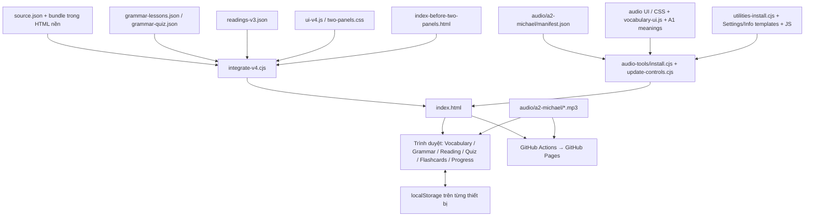
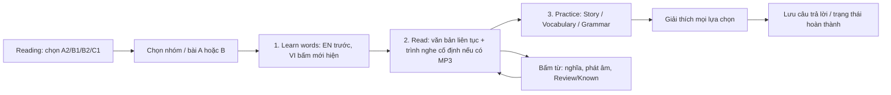
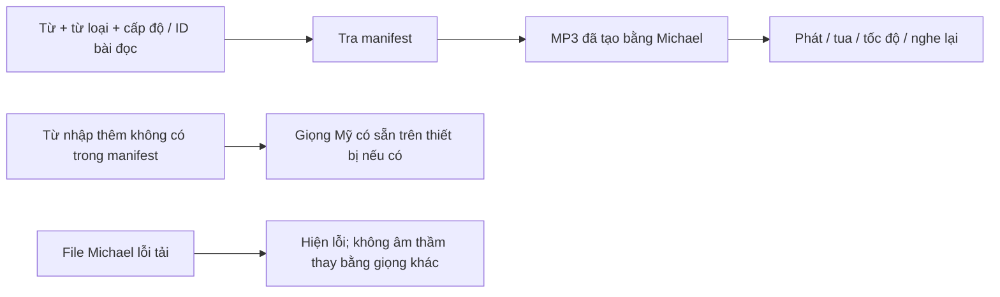

# English Improve — Hồ sơ bàn giao cho AI / lập trình viên

Ngày đóng gói: **06/11/2026** (Asia/Bangkok). Ngôn ngữ trao đổi với chủ dự án: tiếng Việt.

## 1. Đọc nhanh trước khi làm việc

- **Website đang chạy:** https://chanhoang.github.io/English-Improve/
- **Repository:** https://github.com/ChanHoang/English-Improve
- **Nhánh:** `main`.
- **Phiên bản được đóng gói:** `47111861cdef9f00ae633d80c3fe93b6f5f8e50c`.
- **File chạy ngay:** `English-Improve/index.html`. Giải nén toàn bộ ZIP trước khi mở; giữ nguyên thư mục `audio/` bên cạnh.
- **Công nghệ:** ứng dụng web tĩnh HTML/CSS/JavaScript thuần; không React, không máy chủ ứng dụng, không cơ sở dữ liệu phía server, không tài khoản đăng nhập.
- **Tiến độ học:** localStorage của từng trình duyệt. Không tự đồng bộ giữa điện thoại và máy tính.
- **Bản phát hành đã có sẵn:** không cần cài Node hay tạo lại giọng để sử dụng.
- **Để phát triển/kiểm tra:** dùng Node.js 24, tương ứng GitHub Actions hiện tại.
- ZIP chứa mã nguồn, dữ liệu, tài nguyên âm thanh và các kiểm tra; không chứa `.git`, token, tài khoản, node_modules hoặc model cache.
- Tài liệu này phản ánh bản đóng gói. Nếu làm tiếp từ GitHub về sau, kiểm tra commit mới trước khi áp dụng.

### Yêu cầu gần nhất của người dùng — giữ nguyên khi sửa

1. Menu chính: **Vocabulary → Grammar → Reading → Collocations → Quiz → Flashcards → Progress**.
2. Hai cột điều hướng bên trái: mục học ở cột thứ nhất, từ/chủ điểm/bài ở cột thứ hai; nội dung học ở giữa/phải. Điện thoại dùng menu mở/đóng.
3. **Settings** ở đáy menu trái; icon **Info & help** bên cạnh. Hướng dẫn, nguồn bài đọc, nguồn dữ liệu, giọng đọc và nhập CSV nằm trong Info, không rải ở màn hình học.
4. Replay shortcut chọn **Alt+R / R / Space / Off**, tự lưu. Mặc định Alt+R. Không kích hoạt khi nhập văn bản, chọn trường nhập hoặc khi Settings/Info mở.
5. Không có bộ lọc **Review only**. Nút đánh dấu **Review** và **Known** vẫn còn, với ý nghĩa giải thích trong Info.
6. Icon nghe là tai nghe chụp. Không có chữ “Listen (US)” hoặc nút “Replay” bằng chữ dư thừa ở phần từ vựng.
7. Trình nghe bài đọc: **một hàng gọn, cố định phía dưới màn hình**, một thanh thời gian, phát/dừng, tai nghe để phát lại từ đầu, tốc độ 0.5×–2×. **Không có A–B loop**; không khôi phục tính năng cũ này.
8. Nghĩa Việt **đóng mặc định**, bấm “Show Vietnamese meaning” mới hiện; đổi mục từ thì đóng lại. Áp dụng cả danh sách từ và hộp từ trong bài đọc.
9. Giao diện cơ bản bằng tiếng Anh; giải thích học tập bằng tiếng Việt. Có Light/Dark, tự lưu lựa chọn.
10. Chỉ dùng giọng Mỹ cho nút phát âm; không khôi phục lựa chọn giọng Anh–Anh.

## 2. Tình trạng nội dung và âm thanh

| Cấp độ | Mục từ | Nhóm bài đọc | Bài đọc | Có MP3 bài đọc |
|---|---:|---:|---:|---|
| A1 | 1.076 | 0 | 0 | Không có bài đọc A1 theo yêu cầu |
| A2 | 990 | 36 | 72 | Có, toàn bộ |
| B1 | 902 | 34 | 68 | Có, toàn bộ |
| B2 | 1.571 | 56 | 112 | Chưa |
| C1 | 1.404 | 48 | 96 | Chưa |
| **Tổng** | **5.943** | **174** | **348** | **140 bài A2/B1** |

- 120 chủ điểm ngữ pháp; 1.263 câu hỏi ngữ pháp.
- Lộ trình **3.480 Collocations** (chỉ lấy từ vựng A2–C1, 174 nhóm chia làm 10 đợt); đã hoàn thành **Đợt 1 & Đợt 2 gồm 820 Collocations** trong 41 nhóm (hoàn tất **100% cấp độ A2 với 720/720 Collocations trong 36 nhóm**, cộng 40 B1, 40 B2, 20 C1) kèm **410 câu hỏi trắc nghiệm** có giải thích cho cả 3 đáp án.
- 13.066 câu hỏi bài đọc: nội dung câu chuyện, từ vựng và ngữ pháp; có giải thích cho từng lựa chọn đúng/sai.
- Mỗi nhóm bài đọc gồm hai bài A/B, cùng bộ từ mục tiêu, thường 25–30 mục từ. Không gom từ theo thứ tự chữ cái để viết truyện.
- Bài đọc từ A2 trở lên; ưu tiên sự kiện có thật và thú vị, lịch sử, đời sống, khoa học dễ hiểu. Giữ nguồn và phân biệt giả định/ví dụ với sự kiện.
- 5.943 mục từ có hỗ trợ nghĩa Việt: A1 là nghĩa thường gặp do ứng dụng biên soạn; A2–C1 là nghĩa theo ngữ cảnh bài đọc, **không được coi tất cả là bản dịch tương ứng chính xác của định nghĩa English–English**.
- Một số định nghĩa/ví dụ gốc có thể thiếu hoặc khác nghĩa sử dụng trong bài. Phải giữ nhãn thiếu và ghi chú phân biệt nghĩa, không bịa rằng đó là dữ liệu Oxford.
- Âm thanh: **Kokoro Michael**, `am_michael`, US English. 5.009 file từ vựng dùng chung cho 5.943 mục từ; 140 file bài đọc. Tổng **5.149 MP3**, khoảng **189,30 MB**, tổng thời lượng file khoảng **6,49 giờ**.
- Kiểm tra tự động xác nhận file đầy đủ, khung MP3, thời lượng, tín hiệu không rỗng và hash nội dung. Không có tuyên bố rằng con người đã nghe duyệt từng file.

## 3. Sơ đồ kiến trúc



Nếu phần mềm xem tài liệu không hỗ trợ Mermaid: các file dữ liệu + HTML nền được bộ tích hợp ghép thành `index.html`; bộ cài audio/UI bổ sung trình nghe, nghĩa Việt, Settings/Info. Trình duyệt chỉ cần HTML cuối cùng và thư mục audio. GitHub Pages xuất bản đúng hai phần này.

### Luồng học và trạng thái



### Luồng âm thanh



## 4. Bản đồ thư mục — sửa ở đâu

```text
English-Improve/
├── index.html                    Bản chạy đầy đủ, dữ liệu nhúng
├── index-before-two-panels.html   HTML nền; cần cho bộ tích hợp
├── source.json                   Dữ liệu từ vựng cộng đồng gốc đã giữ lại
├── ui-v4.js / two-panels.css      Điều hướng hai cột và luồng học
├── integrate-v4.cjs              Ghép nền + ngữ pháp + bài đọc + UI
├── grammar-lessons.json          120 bài ngữ pháp
├── grammar-quiz.json             Bộ trắc nghiệm ngữ pháp
├── readings-v3.json              348 bài đọc hiện hành
├── readings-before-*.json        Snapshot đầu vào / kiểm tra hồi quy
├── a2-plan.json / b1-plan.json    Phân nhóm từ theo mục tiêu
├── b2-*-plan.json / c1-*-plan.json
├── a2-content/ / b1-content/ / advanced-content/   Nội dung biên soạn
├── build-*-readings.cjs          Bộ dựng dữ liệu bài đọc
├── advanced-sense-notes.json     Ghi chú phân biệt nghĩa nguồn/ngữ cảnh
├── a1-vietnamese.txt             Nghĩa A1, mỗi dòng word=nghĩa
├── vocabulary-ui.js              Tra nghĩa, ẩn/hiện VI, icon tai nghe
├── sidebar-utilities.html        Nút Settings + Info đáy sidebar
├── utility-dialogs.html          Nội dung các cửa sổ Settings/Info
├── site-utilities.js             Mở/đóng, lưu chọn phím, liệt kê nguồn
├── utilities-install.cjs         Chuyển bố cục, gom thông tin, thứ tự menu
├── audio-tools/
│   ├── generate.cjs              Tạo MP3 bằng Kokoro
│   ├── install.cjs               Nhúng manifest / nối audio vào HTML
│   ├── update-controls.cjs       Lắp lại code/CSS UI mới, gọi utilities
│   ├── audio-ui.js               Phát từ, xử lý tải/lỗi, tránh chồng âm
│   ├── audio-controls.js         Trình nghe gọn, tốc độ, phím tắt, theme
│   ├── controls.css              Trình nghe, theme, Settings/Info
│   └── package.json / pnpm-lock.yaml
├── audio/a2-michael/
│   ├── manifest.json            Ánh xạ toàn bộ từ + bài A2/B1 sang file
│   ├── generation.json          Hash, byte, thời lượng, metadata tạo giọng
│   └── *.mp3                    5.149 file hoàn chỉnh
├── test-*.cjs                    Kiểm tra nội dung, UI và audio
└── .github/workflows/pages.yml   Kiểm tra và xuất bản GitHub Pages
```

**Tên thư mục `audio/a2-michael` là tên lịch sử.** Nó hiện chứa toàn bộ từ vựng và bài A2/B1, không chỉ A2. Không đổi tên tùy tiện vì manifest và đường dẫn đã dùng tên đó.

Có nhiều script biên soạn/sửa theo đợt cũ. Không chạy tất cả script theo tên hoặc thứ tự chữ cái. `readings.json`, các `reading-*-ui.js` cũ và HTML snapshot không phải giao diện đang được phục vụ độc lập.

### Bảng định hướng sửa nhanh

| Muốn sửa | Điểm bắt đầu |
|---|---|
| Tên/thứ tự menu, gom Info, bỏ thông tin ngoài màn hình | utilities-install.cjs |
| Nội dung hướng dẫn / thông tin giọng | utility-dialogs.html |
| Nguồn hiện trong Info, hành vi mở Settings/Info | site-utilities.js |
| Tùy chọn và xử lý phím tắt | audio-tools/audio-controls.js + utility-dialogs.html |
| Kích thước/thanh nghe cố định, màu sắc | audio-tools/controls.css |
| Ẩn nghĩa Việt / cách ghép nghĩa / icon tai nghe | vocabulary-ui.js |
| Nghĩa A1 | a1-vietnamese.txt |
| Nghĩa A2–C1 theo bài | targets trong readings-v3.json và file biên soạn tương ứng |
| Điều hướng từ/chủ điểm/bài, quiz | ui-v4.js |
| Lý thuyết/bài tập ngữ pháp | grammar-lessons.json / grammar-quiz.json |
| Bài B2/C1 | advanced-content/ + plan + advanced-sense-notes.json |

## 5. Dữ liệu và các định danh phải giữ ổn định

### Từ vựng

Mảng trong `<script id="bundle" type="application/json">` của `index.html` là dữ liệu từ đang chạy. Một mục có `word, level, pos, def, example, uk, us` và có thể có `vi` khi nhập thêm. Phiên âm `uk` trong dữ liệu không có nghĩa giao diện có lựa chọn giọng UK.

- Khóa tiến độ từ vựng: `JSON.stringify([word, level, pos || '', def || '', example || ''])`.
- Vì định nghĩa/ví dụ có trong khóa, sửa nội dung có thể khiến trạng thái học cũ không còn khớp. Nếu sửa diện rộng cần kế hoạch chuyển khóa.
- `targets[].rowIndex` của bài đọc tham chiếu vị trí trong mảng từ. **Không sắp lại hoặc lọc lại mảng gốc** mà không cập nhật toàn bộ tham chiếu.

### Bài đọc và câu hỏi

Mỗi bài có `id, group, groupTitle, level, part, title, englishTitle, paragraphs, targets, grammar, sources, questions, wordCount` và các trường phụ trợ.

- `paragraphs`: mảng cặp `[English, Vietnamese guide/translation]`.
- `targets`: từ, từ loại, cấp độ, rowIndex, `en`, `vi`; có thể có `occurrence` và `sourceSenseNote`.
- `occurrence`: chỉ đoạn và vị trí ký tự dùng làm nổi bật từ. Sửa văn bản phải cập nhật vị trí hoặc dựng lại bằng bộ biên soạn.
- `sources`: mảng `[tên nguồn, URL]`.
- Câu hỏi: `q, options, answer, explanations`, cùng ID và category/metadata khi có. `answer` là chỉ số, không phải chữ A/B/C.
- Giữ nguyên ID bài/nhóm/câu hỏi đã phát hành nếu không có chủ đích di chuyển dữ liệu.

### Ngữ pháp và điều hướng

120 ID chủ điểm được bài đọc tham chiếu. Không đánh lại số. Mã mode nội bộ vẫn là:

| Mode | Mục |
|---:|---|
| 0 | Vocabulary |
| 1 | Flashcards |
| 2 | Quiz |
| 3 | Progress |
| 4 | Grammar |
| 5 | Reading |
| 6 | Collocations |

Thứ tự hiển thị là `[0,4,5,6,2,1,3]`, không phải đổi ID mode.

### Lưu trữ trình duyệt

Các khóa hiện hành gồm:
`ox5-progress`, `ox5-import`, `ox5-quiz`, `ox5-grammar`, `ox5-grammar-answers-v1`, `ox5-selected-grammar`, `ox5-reading-answers-v3`, `ox5-reading-done-v3`, `ox5-reading-stages`, `ox5-page-size`, `ox5-audio-speed`, `ox5-replay-shortcut`, `ox5-theme`.

Không xóa localStorage để giải quyết lỗi UI. Bản ZIP **không chứa tiến độ cá nhân** của trình duyệt và không tự chuyển tiến độ sang thiết bị khác. Chạy bằng file://, localhost và GitHub Pages là các ngữ cảnh lưu trữ khác nhau; một số trình duyệt còn giới hạn lưu trữ khi mở file cục bộ.

## 6. Chạy và cập nhật đúng cách

### Chỉ sử dụng

Giải nén ZIP → mở `English-Improve/index.html`. Nếu dùng file cục bộ, giữ toàn bộ `audio/`. Nếu trình duyệt hạn chế file://, dùng máy chủ tĩnh của môi trường phát triển hoặc GitHub Pages. Không mở HTML trực tiếp bên trong cửa sổ xem ZIP.

### Sửa trình nghe / Settings / Info / nghĩa Việt / CSS bổ sung

Sửa file nguồn tương ứng, rồi chạy từ thư mục `English-Improve`:

```sh
node audio-tools/update-controls.cjs
```

Bộ cập nhật đọc các file vocabulary/audio/utilities và viết lại phần tích hợp trong `index.html`. Chỉ sửa file JS/CSS nguồn mà không chạy bước này thì website vẫn dùng mã nhúng cũ.

### Sửa UI lõi, ngữ pháp hoặc readings-v3.json

```sh
node integrate-v4.cjs
node audio-tools/install.cjs
```

`install.cjs` tự gọi `update-controls.cjs`, nối lại UI âm thanh, nghĩa Việt và Settings/Info. **Không dừng sau integrate-v4.cjs**, vì bước đó lấy nền cũ và cần lớp cập nhật sau cùng.

### Dựng lại nội dung B2/C1 từ file biên soạn

```sh
node build-advanced-readings.cjs
node integrate-v4.cjs
node audio-tools/install.cjs
```

Chuỗi này đã được thử trên bản giải nén độc lập khi chuẩn bị gói bàn giao. Bộ advanced lấy A2/B1 từ `readings-before-advanced.json`. Nếu sửa A2/B1, cần cập nhật snapshot đầu vào đó đúng chủ đích; nếu không, lần dựng advanced sau có thể đưa A2/B1 cũ trở lại. Không chạy lại bộ dựng để “thử cho chắc” trên bản đang sửa mà chưa có bản sao/commit.

Các bộ dựng A2/B1 cũng sử dụng snapshot theo giai đoạn. Đọc các lệnh read/write trong script trước khi dùng; không giả định mọi bộ dựng đều tăng thêm vào dữ liệu hiện tại.

### Kiểm tra bắt buộc trước khi phát hành

```sh
node test-audio.cjs
node test-audio-controls.cjs
node test-a2.cjs
node test-b1.cjs
node test-advanced.cjs
node test-v4.cjs
node test-collocations.cjs
```

- `test-audio`: toàn bộ MP3, manifest, hash văn bản, độ dài, phân biệt một số từ khác trọng âm.
- `test-audio-controls`: phát/dừng/nghe lại, tốc độ, phím tắt, không có loop, theme.
- `test-a2`, `test-b1`, `test-advanced`: độ phủ từ, số bài/nhóm/câu hỏi, tham chiếu và nội dung cũ.
- `test-v4`: luồng học, giải thích lựa chọn, giữ tiến độ, điều hướng, phân trang, nghĩa Việt, Settings/Info.

Ngoài kiểm tra tự động, kiểm tra bằng trình duyệt: máy tính + điện thoại, Light/Dark, mở/đóng nghĩa Việt, chọn phím tắt rồi tải lại, đổi mục khi đang nghe, tua và cuộn bài với thanh nghe cố định. Đừng sửa kiểm tra chỉ để bỏ qua một lỗi chưa hiểu.

### Đưa bản sửa lên GitHub

ZIP là snapshot, không có lịch sử Git hay cấu hình xác thực. Cách tiếp tục tốt nhất: clone repository, kiểm tra commit đang chạy, rồi đưa các sửa đổi cần thiết từ gói sang checkout đó. Không tạo lịch sử mới đè lên repo hoặc force-push.

Workflow `.github/workflows/pages.yml` chạy 6 kiểm tra trên Node 24, đóng gói `index.html` + `audio/`, rồi triển khai GitHub Pages. Chờ cả build và deploy thành công, kiểm tra website thực tế; không coi push thành công là đã xuất bản xong. Không đưa credential/token vào mã hoặc file bàn giao.

## 7. Tạo hoặc sửa âm thanh

Chỉ cần phần này khi sửa nội dung được đọc hoặc mở rộng audio; các file hiện có đã nằm trong ZIP.

```sh
cd audio-tools
pnpm install --frozen-lockfile
node generate.cjs --scope=all
node install.cjs
cd ..
node test-audio.cjs
```

- `--scope=all` hiện nghĩa là **mọi từ vựng + bài đọc A2/B1**, chưa có nghĩa là tất cả bài B2/C1.
- Bỏ `--scope=all` sẽ dùng phạm vi A2. **Không chạy mặc định rồi xuất bản**, vì manifest có thể bị thu hẹp lại chỉ còn A2.
- Model: `onnx-community/Kokoro-82M-v1.0-ONNX`, fp32 CPU; giọng `am_michael`, speed 1; mono 24 kHz, MP3 64 kbps.
- Cần Internet lần đầu tải dependency và model. Model cache và thư viện không được đóng gói; không cần chúng để phát các MP3 sẵn có.
- Đọc toàn bộ phần thân tiếng Anh, không đọc bản dịch/quiz/tiêu đề. Các đoạn tổng hợp ngắn được ghép thành một file bài đọc.
- Manifest v2 dùng khóa từ `JSON.stringify([word, pos || '', level])`; bài đọc tra theo `id`.
- Có xử lý phiên âm cho các từ đồng hình khác cách đọc/từ loại. Không đơn giản hóa thành một file cho mọi từ viết giống nhau.
- Metadata `generation.json` có input hash, byte, duration, RMS, số phần... để tiếp tục tác vụ và kiểm tra.
- Script có tùy chọn chia worker, nhưng gói này khuyến nghị chạy một tiến trình nếu chưa hiểu cơ chế gộp log; không chạy các worker chồng lên cùng công việc hoặc xuất bản manifest khi file còn thiếu.
- Nếu thay phần thân bài đọc, phải tạo lại MP3 tương ứng trước khi phát hành; kiểm tra hash sẽ phát hiện file cũ.

## 8. Nguồn, phạm vi và giới hạn

- Danh sách tham chiếu: https://www.oxfordlearnersdictionaries.com/wordlists/oxford3000-5000
- Dataset cộng đồng: https://github.com/winterdl/oxford-5000-vocabulary-audio-definition
- Kokoro: https://github.com/hexgrad/kokoro
- Model ONNX: https://huggingface.co/onnx-community/Kokoro-82M-v1.0-ONNX
- Nguồn từng bài đọc nằm trong `readings-v3.json` → `sources`, được tập hợp trong **Info & help**, gồm nguồn bài đang mở và toàn bộ 348 bài.
- Dự án không phải sản phẩm chính thức của Oxford. Không gán một giấy phép chung cho nội dung từ điển/bài học bên thứ ba. Khi tái phân phối công khai hoặc thương mại, xem điều kiện của từng nguồn.
- Không bịa định nghĩa, ghi âm gốc, dẫn chứng hoặc tuyên bố đã kiểm chứng bằng con người.
- Chưa có audio bài B2/C1, đồng bộ tài khoản, backend hoặc cơ chế tải cache offline bền vững như một PWA hoàn chỉnh.
- Các file PDF/Excel tải lên trong những cuộc trò chuyện cũ không được đóng kèm; dữ liệu thực tế cần để chạy và sửa ứng dụng đã nằm trong snapshot mã nguồn/dữ liệu này.
- Các bản nháp chưa được Git theo dõi, thư mục thử giọng, credential helper và công cụ riêng trên máy không nằm trong ZIP. Những phần đó không cần để dùng hoặc dựng lại bản phát hành.

## 9. Kiểm chứng gói và cách nhận bàn giao

Trong ZIP có `PACKAGE-MANIFEST.json`: danh sách file và SHA-256. Ngoài ZIP có file `.sha256` để kiểm tra chính ZIP. Khi kiểm tra checksum, dùng file manifest của đúng phiên bản, không so với repository đã có commit mới.

Khi bàn giao cho AI khác, gửi **ZIP + tài liệu này**, rồi mô tả thay đổi mong muốn. Nếu hệ thống AI giới hạn dung lượng tải lên, có thể cho AI đọc repository và tài liệu trước; ZIP vẫn là bản dự phòng đầy đủ có âm thanh.

### Đoạn yêu cầu có thể gửi cho AI tiếp nhận

> Đây là dự án English Improve đang hoạt động. Hãy đọc PROJECT_HANDOFF.md trước, giải nén ZIP và xem README, ui-v4.js, utilities-install.cjs cùng các file liên quan đến yêu cầu của tôi. index.html là bản chạy đã tích hợp; không xây lại từ đầu hoặc thay framework. Giữ các yêu cầu giao diện gần nhất, định danh bài học và tiến độ. Không khôi phục UK voice, Review only hoặc A–B loop. Sửa cả nguồn và bản HTML tích hợp, chạy các kiểm tra cần thiết, kiểm tra giao diện rồi mô tả rõ thay đổi. Chỉ xuất bản khi nhiệm vụ tôi giao có yêu cầu đó. Yêu cầu tiếp theo của tôi là: [ghi thay đổi mong muốn ở đây].

### Checklist nhận dự án

- [ ] Mở được index.html và nghe được một từ + một bài A2/B1 sau giải nén.
- [ ] Đúng 5.943 mục từ, 120 chủ điểm, 348 bài đọc; menu đúng thứ tự.
- [ ] Không có lỗi nguồn âm thanh; không nhầm B2/C1 đã có MP3 bài đọc.
- [ ] Nghĩa Việt đóng mặc định; Settings/Info hoạt động; phím tắt lưu được.
- [ ] Xác định đúng file nguồn và bước tích hợp trước khi sửa.
- [ ] Giữ ID/rowIndex và localStorage; nếu cần đổi phải có migration.
- [ ] Chạy các kiểm tra trước khi phát hành; xác nhận Pages sau khi triển khai.


## 12. Real Non-AI Illustrative Photos (`real-photo-ui.js`, `photo-topics.json`, `test-real-photos.cjs`)

- **100% Real Photographs (Non-AI)**: Uses Wikipedia PageImages batch API (`fetchWikiBatch`, up to 25 titles per request) and Wikimedia Commons bitmap search (`filetype:bitmap -ai -midjourney -map -diagram -logo -icon -svg`) with `isRealPhotoUrl()` filtering out SVG/GIF icons, flags, maps, diagrams, and AI-generated images.
- **Vocabulary (`5,943 entries`)**: Every word card displays a real photograph (`vocabPhotoCard`) paired with a contextual Vietnamese & English vocabulary hint (`Gợi ý "<word>": ...`) derived from `photo-topics.json`, `EXACT_WORD_VISUALS`, 450+ concrete visual anchor keywords, and semantic domain fallbacks.
- **Flashcards (`mode === 1`) & Quiz (`mode === 2`)**: Both the front of every flashcard (before flipping) and the flipped back, as well as vocabulary quiz questions, show a real photograph as a visual memory clue.
- **Reading Passages & Paragraphs (`348 readings / 608 paragraphs`)**:
  - Header displays a hero real photograph (`readingPhotoCard`) summarizing the reading subject and key target words.
  - Stage 0 (`Learn the words`) displays a real photograph on every word card and inside the popup word dialog (`#reading-word-dialog`).
  - Stage 1 (`Read`) displays a dedicated real photograph (`readingParagraphPhoto`) for every paragraph `<p>` with a vocabulary hint listing the target words in that paragraph (`Gợi ý từ vựng trong đoạn: ...`), plus a 3-photo scene gallery (`readingSceneGallery`) for single-paragraph readings.
- **Collocations (`820 active collocations`) & Grammar (`120 topics`)**: Every collocation card, collocation word modal, and grammar lesson displays a contextual real photograph.
- **Automated Test**: Run `node test-real-photos.cjs` alongside the other 7 test suites.
